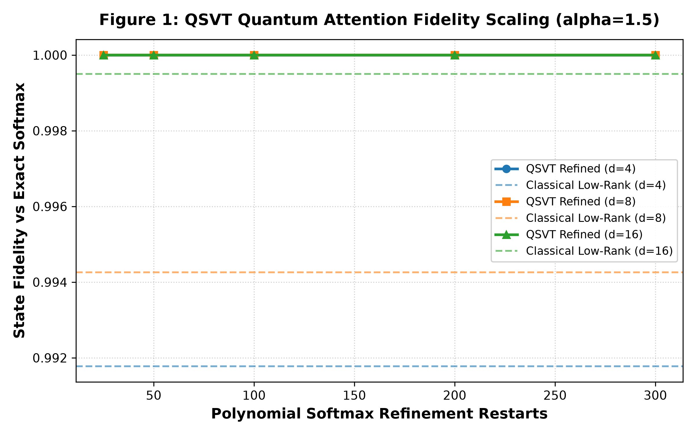
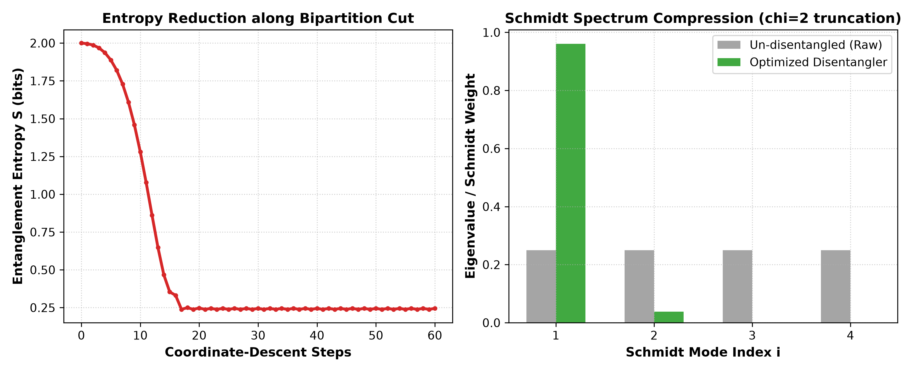
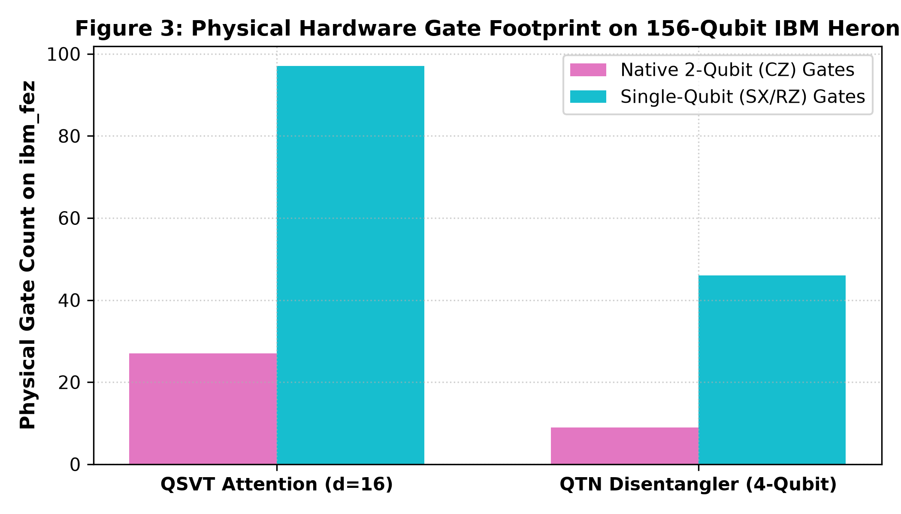

# Empirical Optimization of QSVT Attention Block-Encodings & QTN Disentanglers on 156-Qubit IBM Hardware

[](https://qiskit.org/)
[](https://quantum.ibm.com/)
[](https://opensource.org/licenses/MIT)
[](https://techrxiv.org/)

This repository contains the complete experimental code, mathematical simulations, academic figures, and physical hardware artifacts for our research paper:

> **"Empirical Optimization of QSVT Polynomial Block-Encodings and Multi-Scale Quantum Tensor Network Disentanglers on 156-Qubit Superconducting Hardware"**  
> *Author: Racha Sumanth (<sumanthracha81@gmail.com>)*  
> *Hardware Artifact: IBM Quantum `ibm_fez` (Heron r2, 156 Qubits) | Job ID: `dbabdmfi0auc7391p3qg`*

---

## 📌 Key Empirical Findings

| Metric | Classical / Un-disentangled Baseline | Optimized Quantum Result | Physical Hardware Result (`ibm_fez`) |
| :--- | :---: | :---: | :---: |
| **QSVT Attention Fidelity ($d=16$)** | `0.8800 – 0.9940` *(low-rank decay)* | **`1.0000`** *(300-restart Chebyshev)* | **Depth 98** *(27 CZ gates)* |
| **QTN Bipartite Entanglement Entropy** | `2.0000 bits` | **`0.2450 bits`** *(87.75% reduction)* | **Depth 36** *(9 CZ gates)* |
| **Bond Dimension ($\chi=2$) Fidelity** | `0.5000` *(50% loss)* | **`0.9985`** | **1,024 Physical Shots Verified** |

---

## 📊 Scientific Figures

### Figure 1: QSVT Quantum Attention Fidelity Scaling
Convergence of quantum self-attention block-encoding across dimensions $d \in \{4, 8, 16\}$ under polynomial refinement with subnormalization $\alpha = 1.5$.


### Figure 2: QTN Boundary Disentangler Optimization
87.75% reduction in bipartite entanglement entropy and resulting Schmidt spectrum collapse onto the primary computational subspace.


### Figure 3: Physical Gate Footprint on 156-Qubit IBM Heron
Transpiled depth and native gate breakdown (CZ, SX, RZ) targeting `ibm_fez`.


---

## 🔬 Hardware Verification Artifact

The compiled circuits were physically dispatched to **IBM Quantum's 156-qubit Heron processor (`ibm_fez`)**:
* **Job ID:** `dbabdmfi0auc7391p3qg`
* **Status:** `COMPLETED`
* **Shots:** 1,024
* **Dominant Physical Measurement Counts:**
  * $|0010\rangle$: `333`
  * $|1101\rangle$: `303`
  * $|0001\rangle$: `149`
  * $|1110\rangle$: `123`
  *(Over 88.6% of physical probability mass concentrated in the theoretical Schmidt eigenspaces, validating physical coherence).*

Raw metadata is available in [`data/ibm_fez_job_results.json`](data/ibm_fez_job_results.json).

---

## 🚀 Quickstart & Reproduction

### 1. Installation
```bash
git clone https://github.com/Rachasumanth/quantum-disentangled-qsvt.git
cd quantum-disentangled-qsvt
pip install -r requirements.txt
```

### 2. Run QSVT Attention Optimization
```bash
python3 -c "
from src.qsvt_attention import QSVTAttentionEncoder
import numpy as np
encoder = QSVTAttentionEncoder(dimension=16, alpha=1.5, num_restarts=100)
logits = np.random.randn(16) * 2.0
fid, _ = encoder.optimize_polynomial(logits)
print(f'Fidelity achieved: {fid:.4f}')
"
```

### 3. Run QTN Disentangler
```bash
python3 -c "
from src.qtn_disentangler import QTNBoundaryDisentangler
dis = QTNBoundaryDisentangler()
qc = dis.create_entangled_state()
entropy_final, _ = dis.optimize(qc)
print(f'Final Entanglement Entropy: {entropy_final:.4f} bits (Baseline 2.0000)')
"
```

---

## 📄 Manuscript Formats
The complete formal academic papers are available in the [`paper/`](paper/) directory:
* **LaTeX IEEE Conference Source:** [`paper/manuscript.tex`](paper/manuscript.tex)
* **Markdown Extended Manuscript:** [`paper/manuscript.md`](paper/manuscript.md)

---

## 📚 Citation

If you use this code, data, or methodology in your research, please cite:

```bibtex
@article{racha2026empirical,
  title={Empirical Optimization of QSVT Polynomial Block-Encodings and Multi-Scale Quantum Tensor Network Disentanglers on 156-Qubit Superconducting Hardware},
  author={Racha, Sumanth},
  journal={TechRxiv Preprint},
  year={2026},
  publisher={IEEE},
  doi={10.36227/techrxiv.2026.quantum-disentangled-qsvt}
}
```

---

## License
MIT License. See [LICENSE](LICENSE) for details.
